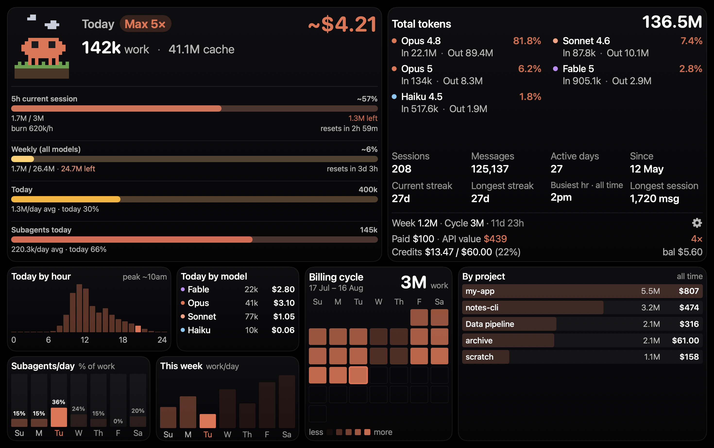
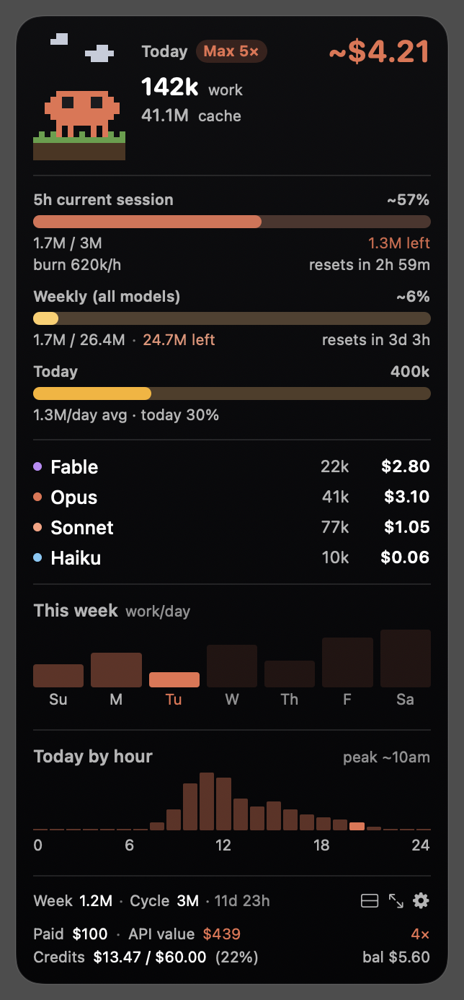
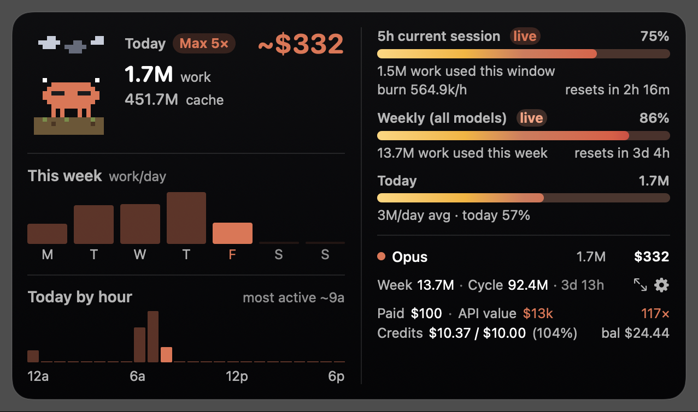
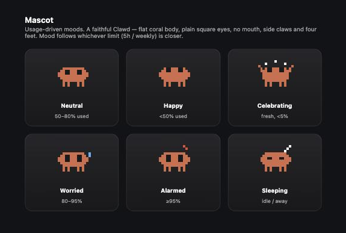

# ClaudePet 🐾

A tiny native-macOS desktop pet that watches your Claude usage. A coral pixel critter sits on
your desktop and shows, at a glance, how close you are to your limits — reading your **local**
Claude Code logs only. **No API key, no network, no token.**

The pet's design is an original code-drawn homage to **Clawd**, the Claude Code terminal mascot
(Anthropic) — no artwork assets are copied or bundled.

<p align="center">
  
</p>

<p align="center">
  
  &nbsp;&nbsp;
  
</p>

## What it shows

**On the desktop widget**

- **Today** — work tokens (input + output), total billable tokens (incl. cache), and notional cost.
- **5-hour session** — a gauge toward your limit (live from Claude's real numbers when available),
  burn rate, and a reset countdown.
- **Weekly (all models)** — your 7-day usage with its own reset countdown.
- **Today's pace** against your usual day — the average of your last 30 days that had any usage, so
  it doesn't go blank every time the weekly limit resets.
- **By model**, **this week** per day, and **today by hour**.
- Week & cycle totals with a billing line.

**In the dashboard** (the ⤢ button, or a real full-screen window)

- Claude Code's own lifetime **`/stats` total**, live — the same figures `/stats` would print right
  now, even if you haven't opened it in weeks — with each model's share, plus lifetime **KPI tiles**:
  sessions, messages, active days, most active day, streaks, longest session, peak hour.
- **This billing cycle as a calendar** — one shaded cell per day, denser where you worked harder.
- **Subagents today** as a pace bar, and **Subagents/day** as each day's delegated share on a fixed
  0–100% axis — turns run by the Task tool, including workflow agents.
- **By project** — which projects burned your tokens **all time**, resolved from each turn's own
  working directory rather than guessed from folder names.

> **This week** and **Subagents/day** run on a fixed **Sunday-to-Saturday calendar week**, on purpose
> — so a day's tokens always land in exactly one bar. That's deliberately *not* the weekly-limit
> window above them, which keeps its own real reset schedule (e.g. Monday 3 PM).

**The pet reads two numbers at once**

Its **face and sky follow your 5-hour session**; the **ground it stands on follows your week**. So a
calm pet on cracked earth means *plenty of session left, almost no week* — and a storm over lush
grass means the opposite. Nine moods, eight skies and five states of ground; it sleeps when you're
away. Hover it and it says exactly what it's showing.

## Install (macOS 14+)

1. Download **`ClaudePet-x.y.z.dmg`** from the [Releases](../../releases) page.
2. Open the DMG and **drag ClaudePet to Applications**.
3. **First launch only** — the app is signed ad-hoc (not via a paid Apple Developer account), so
   macOS Gatekeeper asks for a one-time confirmation:
   - **Right-click** `ClaudePet` in Applications → **Open** → **Open** in the dialog. *(Just
     double-clicking the first time will refuse — use right-click → Open.)*
   - Or, in Terminal: `xattr -dr com.apple.quarantine /Applications/ClaudePet.app`

After that it opens normally. It's a **dockless agent** (no Dock icon) — the pet just appears on
your desktop. Drag it anywhere; it floats above other windows, shows on all Spaces, and remembers
its position. Enable **Launch at login** in Settings to keep it around.

## Using it

- **Drag** the pet to reposition. Hover to reveal resize handles.
- Click the **⚙ gear** for Settings.
- Two layouts — **tall** single-column and **wide** two-column. Switch them from the widget's own
  layout button, or Settings → Appearance.
- Click **⤢** to open the **dashboard** — a real resizable window that goes full screen (⌃⌘F).
- Hover the gauges/numbers for tooltips explaining each value.

## Live data — link to your Claude account

Out of the box, ClaudePet *estimates* your limits from local logs. To show Claude's **real**
5-hour and weekly usage (a **`live`** badge on the gauges), link it to your account through
[**claude-statusline**](https://github.com/andrewii23/claude-statusline) — a separate tool that
authenticates and writes a small local usage cache. ClaudePet only *reads that file*; it never
touches your token or the network.

1. **Install claude-statusline** following its README.
2. **Add it as your Claude Code status line** in `~/.claude/settings.json`:
   ```json
   "statusLine": { "type": "command", "command": "bash ~/.claude/statusline.sh" }
   ```
   The first run authorizes it against your Claude account.
3. **Use Claude Code once** so the status line runs — it writes
   `/tmp/claude/statusline-usage-cache.json`.
4. Done: ClaudePet has **"Use Claude's live usage"** on by default (Settings → *Match the Claude
   app*) and picks up the cache automatically — the gauges switch to Claude's real % with a `live`
   badge. No live data yet? You can still **calibrate** the gauges by hand in Settings to match
   what `/usage` shows.

> ClaudePet reads **only** the local cache file — no OAuth token, no network. claude-statusline is
> the component that links to your account; install it only if you're comfortable with that.

## Settings (⚙)

Budget source (auto-peak / plan / custom), tokens-vs-US$ unit, live-data toggle (reads
[claude-statusline](https://github.com/andrewii23/claude-statusline)'s local cache when present
for Claude's *real* numbers), manual calibration, weekly reset day & time, billing-this-cycle,
widget size, layout, launch-at-login, and an editable pricing table.

Three that change what the numbers *mean*, not just how they look:

- **Count tokens as — Work or Total.** Work is input + output; Total also counts cache reads and
  writes, which under always-on prompt caching are the overwhelming majority. The same week can read
  31% delegated on Work and 11% on Total, because a subagent's short-lived context re-reads far less
  cache than the main conversation does.
- **Include subagent usage.** Off removes every Task-tool and workflow-agent turn from every figure
  in the app.
- **Count repeated log lines (match `/stats`).** Transcripts re-log one API response several times;
  by default ClaudePet keeps the first per `message.id`. Turning this on counts every line instead,
  which is what Claude Code's own `/stats` does — and roughly triples the totals.

## Privacy

ClaudePet reads only local files under `~/.claude` (your transcripts, `~/.claude.json`, and —
if installed — the statusline's local cache), plus your Mac's own temperature sensors for the
header's device readout. It **never** reads your OAuth token, and it makes **no network requests**. Token counts come straight from your transcripts; cost is a *notional*
API-equivalent estimate (you're likely on a subscription).

## Uninstall

Quit (Settings → Quit, or `pkill -x ClaudePet`), then drag `/Applications/ClaudePet.app` to the
Trash. Preferences live in `~/Library/Preferences/com.napat.ClaudePet.plist`.

## Design system

The widget's look is mirrored as a small, self-contained HTML component library in
[`frontend/`](frontend/) — colours, typography, the mascot, the gauges, and both widget layouts.
Open any file in a browser to preview it, or import the whole set into
[claude.ai/design](https://claude.ai/design) with the `/design-sync` skill. Details in
[`frontend/README.md`](frontend/README.md).

> **Note:** the mirror is generated, and currently lags the app — it predates the dashboard, the
> ground layer, the three newest moods and the current gauge palette. Treat the app as the source of
> truth until it's regenerated.

<p align="center">
  
</p>

## Build from source

Requires Xcode 16 / Swift 6 on macOS 14+.

```bash
git clone https://github.com/jjnnaappaatt/ClaudePet.git
cd ClaudePet
swift test            # data-engine unit tests
./bundle.sh release   # build ClaudePet.app (ad-hoc signed, non-sandboxed)
open ClaudePet.app
./release.sh          # optional: package dist/ClaudePet-<version>.dmg
```

**Architecture:** `ClaudePetCore` is pure, unit-tested Swift (models, JSONL parser + dedup,
aggregator, 5-hour/weekly engines, pricing, `MetricsStore`, mascot logic). The app layer is a
`FloatingPanel` (NSPanel) hosting SwiftUI, with a pixel-matrix mascot renderer. A web mirror of
the UI (for [claude.ai/design](https://claude.ai/design)) lives in `frontend/`.

Want to contribute? See [`CONTRIBUTING.md`](CONTRIBUTING.md).

## License

[MIT](LICENSE) © 2026 JJ_NAPAT.
